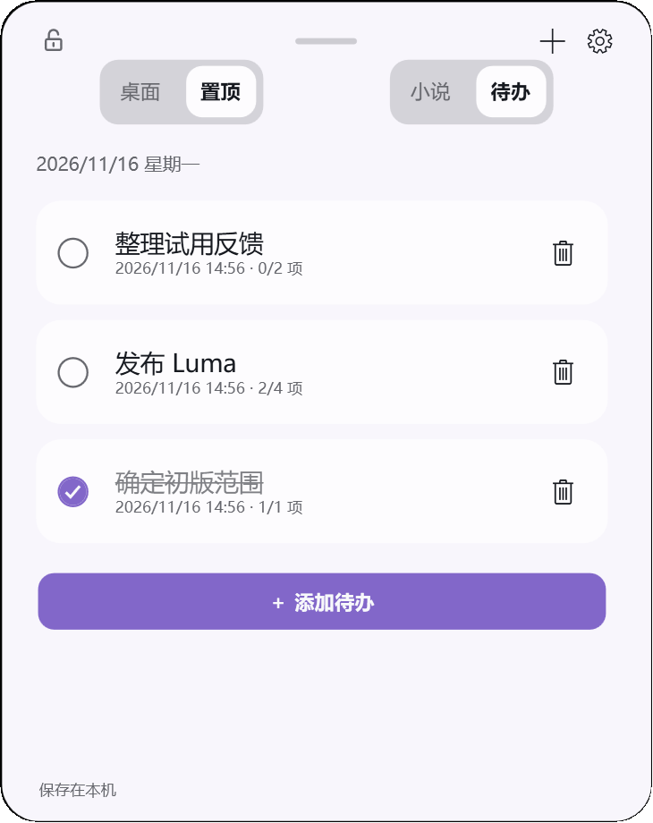
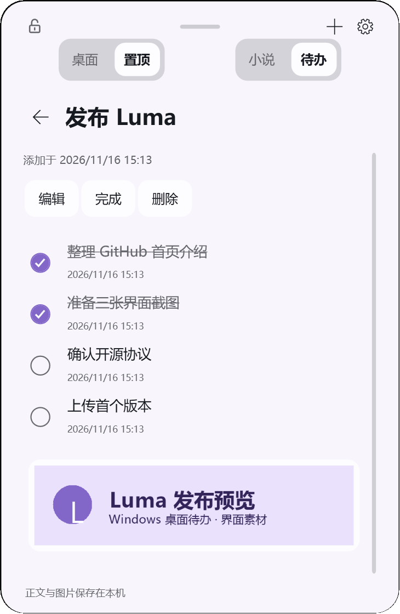
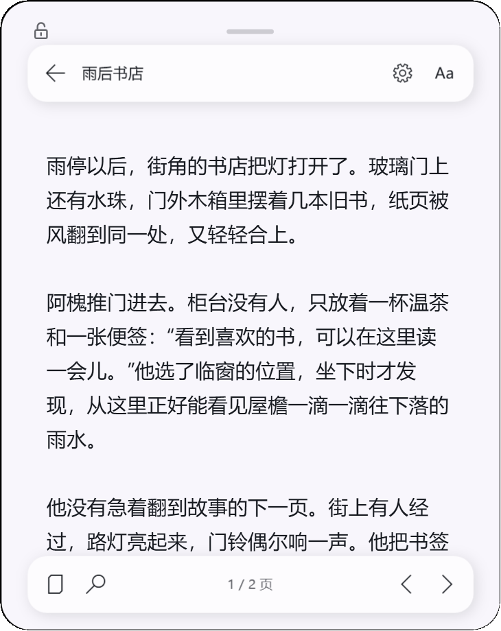

# Luma

**Luma 是一款 Windows 桌面小工具，可以贴待办、置顶清单，也可以用小窗口离线读小说。**

平时把清单贴在桌面。需要一边看资料一边做事，就点「置顶」，做完一项勾一项。休息时切到「小说」读几页，用快捷键收起窗口，下次接着读。待办和书籍保存在本机，无需注册账号。

## 两层待办，正文可以放图片

比如建一条「发布 Luma」的主待办，在详情里添加「写介绍」「准备截图」「确认协议」「上传版本」。列表会显示 `2/4 项` 这样的进度。每个子待办可以独立勾选，整条待办也有自己的完成按钮。

编辑时可以在正文里写说明，用 **Ctrl + V** 粘贴截图，或者把本机图片拖进去。编辑和详情都能直接看到图片，在详情里双击可用 Windows 的图片查看器打开原图。待办保存为 Markdown，图片附件也保存在本机。

<p>
  
  
</p>

## 摸鱼阅读

在「小说」里导入本机的 TXT 或无加密 EPUB。阅读时鼠标移进正文，工具栏就会淡出。把鼠标移到窗口上方或下方，可以打开目录、搜索正文或翻页。

- **怎么读**：可选上下滚动或左右翻页。分页时可以用方向键，也可以开启滚轮或点击左右半区翻页。
- **怎么调**：在阅读页点「Aa」，可调整字体、字号、行距和左右留白。阅读配色可跟随应用外观，也可选护眼色或自定义颜色。
- **怎么收起**：默认用 **Ctrl + Shift + T** 隐藏或唤出窗口。开启「记住阅读位置」后，下次打开同一本书可以接着读。



## 透明度与窗口

点右上角齿轮，在「外观」里拖动「背景透明度」滑块。**0% 是不透明，最高可调到 80%。** 背景实时变化，文字和按钮仍保持原来的不透明度。日间、夜间的背景色可以分别设置，也可以用屏幕吸管取色。想让小说阅读页跟着卡片的外观变化，在「阅读配色」选「跟随外观」。


「桌面」模式把卡片放在桌面层，「置顶」让卡片浮在普通窗口上方。开启贴边自动隐藏后，把卡片拖到屏幕边缘，移开鼠标就会收起，点边缘的小把手即可恢复。也可以从系统托盘打开。

## 下载与使用

1. 在仓库顶部打开 **Releases**，下载 Windows x64 发布包并解压。
2. 双击 **Luma.exe**。在顶部点「＋」新建待办，或在「小说」页点「导入小说」。
3. 默认用 **Ctrl + Shift + T** 唤出或隐藏卡片。可以在设置里更改快捷键，也可以从系统托盘打开。

在一般 Windows 环境中，配置和笔记保存在 `%LOCALAPPDATA%\DesktopNotes` 下的 `config` 和 `notes` 目录。备份时可以一起复制这两个目录。

## 从源码构建

项目使用 C#、WPF 和 .NET 10。在 Windows 上安装 .NET 10 SDK 后，从仓库根目录运行：

```powershell
dotnet build .\src\DesktopNotes.csproj -c Release
```

如需生成自包含的 Windows x64 单文件：

```powershell
dotnet publish .\src\DesktopNotes.csproj -c Release -r win-x64 --self-contained true
```

## 开源协议

授权条款见仓库根目录的 [LICENSE](LICENSE)。
